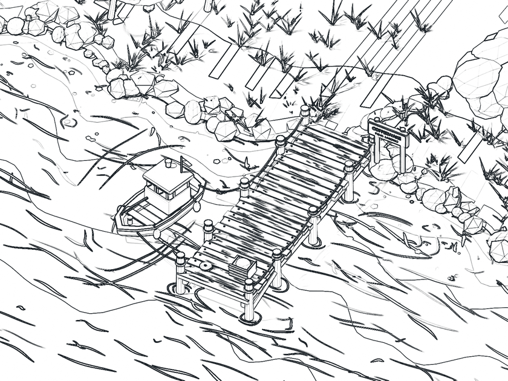
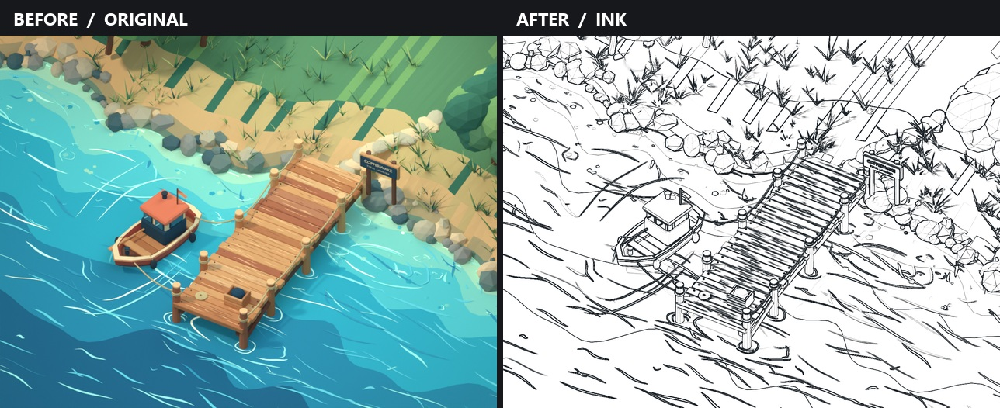
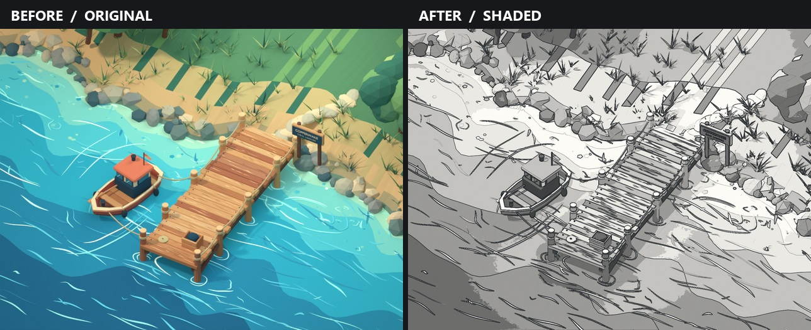

# SketchBlend

Sketch, ink, and stylized render presets for Blender 5.3+. Tune outlines, shading, and print effects without changing your original scene.

**Install:** Download [SketchBlend 0.6.1](SketchBlend-0.6.1.zip). In Blender, open **Preferences → Get Extensions → Install from Disk** and select the ZIP. Open **3D View → N → SketchBlend**, choose a preset, and press **F12**.

All existing presets are included. Styled scenes share model edits with the original scene.
